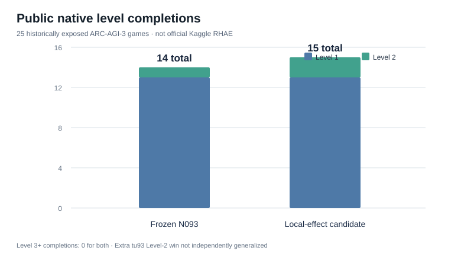

# Learning to explore ARC-AGI-3 games

We built a reinforcement learning agent for ARC-AGI-3's interactive games. Unlike a static puzzle, the agent has to discover what its actions do. It sees a 64×64 game frame, chooses a legal action, observes the result and tries to make progress. Our main question was whether remembering the visual effects of previous actions could improve exploration when rewards are sparse.

## Approach

We tested three versions of a Bellman/Q-based controller:

- **N093:** optimistic Q-value updates and PUCT-style one-step action ranking.
- **N117:** the same controller, with local action-effect memory to guide exploration.
- **E126:** adds observed click feedback and a pretrained visual-effect predictor for sparse click-only scenes.

The [source code](src/) contains all three agents and the readable local-effect policy. The [E126 notebook](E126_Kaggle_Candidate.ipynb) packages the agent for the competition interface; its builder, model checkpoint and checksums are in [release/](release/).

## Results on public games

We evaluated the agents on 25 public game families using the native SDK. Rewards came from completed levels, not simply changing pixels on the screen.

| Agent | Level 1 | Level 2 | Level 3+ | Total levels |
|---|---:|---:|---:|---:|
| N093 | 13 | 1 | 0 | **14** |
| N117 | 13 | 2 | 0 | **15** |
| E126 (seed 76) | 14 | 2 | 0 | **16** |

N117 completed an additional Level 2 on `tu93`. In the original N093/N117 comparison, the agents used 2,982 and 2,790 charged SDK actions respectively. A shorter run does not necessarily mean better efficiency, since the game can terminate before the 200-action-per-level policy limit. The [N093 results](results/n093_public25.csv) and [N117 comparison](results/n117_public25.csv) include the game-by-game outcomes.



The [game-by-game progression matrix](results/plots/family_completion_matrix.svg) shows where the two agents completed individual levels.

E126 was evaluated with three policy seeds:

| Seed | N117 levels | E126 levels | N117 mean SDK score | E126 mean SDK score |
|---|---:|---:|---:|---:|
| 76 | 15 | 16 | 2.093242 | 2.211518 |
| 77 | 14 | 16 | 2.054775 | 2.223942 |
| 78 | 15 | 16 | 2.096435 | 2.240737 |

The E126 agent completed `s5i5` Level 1 across all three runs, while click feedback recovered `lf52` for seed 77. The average local SDK score increased from 2.081484 to 2.225399. The [full comparison](results/e126_all_arms.csv), [per-game data](results/e126_per_game.csv) and [paired changes](results/e126_paired_changes.csv) are included in the repository.

## What we learned

The [N117 ablations](results/n117_ablations.csv) compared local-effect memory, curiosity, novelty, skill variants and controls on a 13-game subset. Local-effect memory and pixel novelty both produced an extra Level-2 completion. Counting any pixel change or shuffling the effect observations removed the gain, so the result supports effect-aware action selection without isolating one unique mechanism.

For E126, we compared a trained effect predictor against random-weight and salience-based alternatives. We also tested different click-ranking rules and additional policy seeds; the [robustness results](results/e126_robustness.csv) record these comparisons.

We tried several other ideas during development, including object-based planning, joint actions, forward prediction and episodic value models. None established a new Level-3 completion. The original experiments, including negative results and native replay instructions, are preserved in the [research archive](https://github.com/Stralb/arc-agi-3-rl-research/tree/archive/full-research-2026-10-27).

## Reproducing the checks

With Python 3.11+ installed, run the following from the repository root:

```bash
python3 scripts/verify_repository.py
python3 release/build_candidate.py
python3 scripts/verify_e126_release.py
python3 -m unittest test_repository -v
python3 scripts/summarize_results.py
```

For additional plots:

```bash
python3 -m pip install -r requirements.txt
python3 scripts/generate_plots.py
```

These commands verify the saved results, source hashes and notebook packaging. They do not run the native game environment. The original SDK and frame-level traces are separate from this repository; the [archived reproduction notes](https://github.com/Stralb/arc-agi-3-rl-research/blob/archive/full-research-2026-10-27/docs/REPRODUCIBILITY.md) describe the original setup.

## Evaluation scope

All 25 game families were available during development, so these results are public-development evaluations rather than independent tests on unseen games. Some policy seeds also produced identical starting frames. The SDK scores reported here are local evaluation metrics, not official Kaggle leaderboard scores.

## Original neural DQN/PPO coursework source

The [neural coursework source](neural_coursework/) preserves the original Wits cluster Double DQN and PPO baseline learners, a selected structured DQN variant with five cross-fold representation checkpoints, its tested native-action adapter/runner, and [the earlier DQN component-ablation study](neural_coursework/earlier_dqn_component_study/). The repository includes the original source, configurations, tests and source-scoped reproducing notes. A cluster virtual-environment check on 27 October 2026 passed 39 tests (4 skipped), including PPO joint masked log-probability verification and loading the selected DQN effect prior.

These artifacts do **not** establish that the full later four-game, seven-arm coursework implementation and all of its DQN/PPO improvement-specific native trajectories are present; the exact later PPO-I1/PPO-I2 and DQN-I2 implementation provenance remains unresolved. See [scope and reproduction limits](neural_coursework/README.md) before making historical replay or Kaggle-submission claims.
