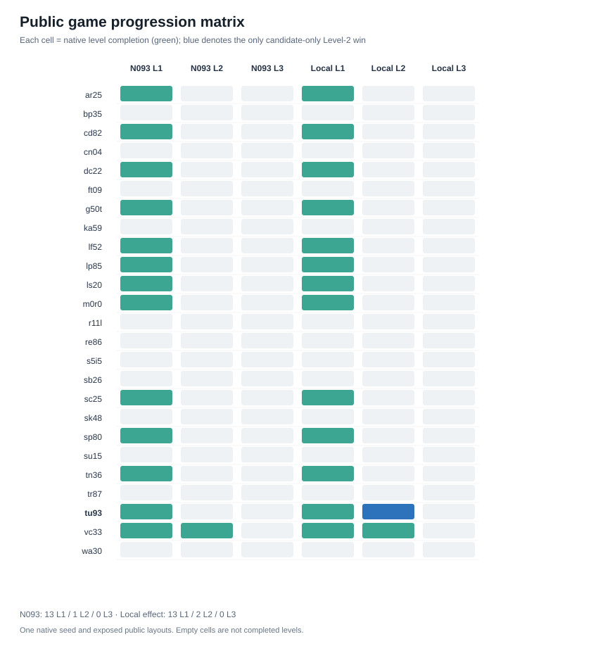

# ARC-AGI-3 — Reinforcement Learning Agents and Experimental Evidence

**Repository:** `Stralb/arc-agi-3-rl-research` · **Status:** Public, own code and derived results only; official SDK and original game assets excluded.

**PUBLISHING STATUS (2026-10-26): CURATED PUBLIC ARCHIVE.** Both self-contained agent sources and both Kaggle-format notebooks are now committed. Reports, core tabular evidence and SVG plots are also present. The much larger offline archive is *not* fully published: original native trace/frame archives, third-party SDK files and some intermediate scripts remain outside the public GitHub tree. The original N114 and N117 native runners and replay verifiers are now committed for authorized local reproduction. See [coverage](docs/REPOSITORY_COVERAGE.md).

This repository organizes a multi-experiment, Kaggle-legal ARC-AGI-3 interactive-agent research project. It contains reproducible Python agent sources, the frozen and experimental Kaggle notebooks, reports, per-family and per-action result files, failure studies and generated plots. The evaluations use **25 historically exposed public interactive game fixtures** and the **native SDK action interface**, not ARC-AGI-1's 400+400 static grid tasks.

## Most important result

| Agent | Level 1 | Level 2 | Level 3+ | Total public levels | Status |
|---|---:|---:|---:|---:|---|
| **Best measured public: local effect-memory** (`src/best_public_agent.py`) | 13 | **2** | 0 | **15** | Research candidate; not independently generalized |
| **Frozen B1 + N093 pretrained PUCT** (`src/baselines/frozen_n093.py`) | 13 | 1 | 0 | 14 | Immutable, conservative fallback |

The new local-effect Level-2 winner is `tu93`; both agents clear `vc33` Level 2. No tested method completed Level 3. **Neither score is an official Kaggle leaderboard score or human-normalized RHAE.** Lower total action counts can reflect earlier native `GAME_OVER`, not efficiency improvements.

> **Public distribution caveat:** The live GitHub repository includes a curated subset of the much larger offline archive. See [repository coverage](docs/REPOSITORY_COVERAGE.md), [research decisions](reports/RESEARCH_DECISIONS.md) and [provenance](data/provenance/README.md). No private Kaggle score or new Level-3 win is claimed.

## Browse the committed research

- [Complete research-report index](reports/INDEX.md)
- [Experiment implementations and protocols](experiments/INDEX.md)
- [Results tables and plots](data/outputs/INDEX.md)
- [Original archive SHA-256 evidence](data/provenance/ARCHIVE_SHA256_MANIFEST.json)
- [Published-versus-omitted evidence inventory](docs/REPOSITORY_COVERAGE.md)
- [Offline reproduction and CI checks](docs/REPRODUCIBILITY.md)

## Structure

```text
src/                  Best public measured agent, frozen baseline, algorithm module
notebooks/            Original frozen and local-effect Kaggle-format submissions
experiments/          N093 and N101–N120 experimental Python, protocols and tests
reports/              Research synthesis, archived original reports and full findings
data/outputs/         Native summary matrices and selected action-level diagnostics
data/outputs/plots/   Committed SVG figures; PNGs regenerate locally
data/provenance/      File-level source/hashes and original asset manifest
scripts/              Offline verification, plot regeneration, authorized SDK staging
tests/                Repository integrity and benchmark-consistency checks
.github/workflows/    Offline CI that never submits or downloads competition games
```

## Quick start

```bash
git clone https://github.com/Stralb/arc-agi-3-rl-research.git
cd arc-agi-3-rl-research
python3 scripts/verify_repository.py
python3 -m unittest discover -s tests -v
python3 -m pip install -r requirements-analysis.txt
python3 scripts/generate_plots.py
```

The first two checks use only the Python standard library and validate the published subset. They do not validate unavailable original native frames or private Kaggle scores.

## Read the results

- [`reports/RESEARCH_SUMMARY.md`](reports/RESEARCH_SUMMARY.md): scientific conclusions, exact baseline comparison and risks.
- [`reports/EXPERIMENT_CATALOG.md`](reports/EXPERIMENT_CATALOG.md): prior experiments and verified negative controls.
- [`data/outputs/benchmarks/n117_local_vs_frozen_25.csv`](data/outputs/benchmarks/n117_local_vs_frozen_25.csv): complete per-family comparison.
- [`data/outputs/plots/`](data/outputs/plots/): plots of native completions, progression, budget, and predictive tradeoffs.
- [`docs/REPRODUCIBILITY.md`](docs/REPRODUCIBILITY.md): code, inputs, provenance and actions counted.
- [`docs/DATA_AND_LICENSES.md`](docs/DATA_AND_LICENSES.md): competition data and third-party license restrictions.

## Reproducibility and scientific claims

All published counts in this snapshot refer to **archived native local runs**, not fresh runs during GitHub packaging. Original source and data hashes are logged under `data/provenance/`. Results are from exposed development/public fixtures; model-selection on those fixtures prevents claims of independent generalization.

The Kaggle deployment and leaderboard status is unknown. Neither notebook has been submitted from this repository. The frozen N093 checkpoint is embedded in both source files.

**Research snapshot:** 2026-10-26.

## Key public benchmark figures




These plots are computed from historically exposed public runs and are not an official competition score.

## E126 Kaggle submission candidate

The frozen N117 agent has a newly packaged hybrid extension, E126,
combining local click feedback with a selectively activated teammate
pretrained action-effect model. Full details:
[experiments/E126/README.md](experiments/E126/README.md).
The [candidate notebook](notebooks/E126_Kaggle_Candidate.ipynb)
is **not submitted**. No hidden-score improvement beyond 0.33 is verified.
