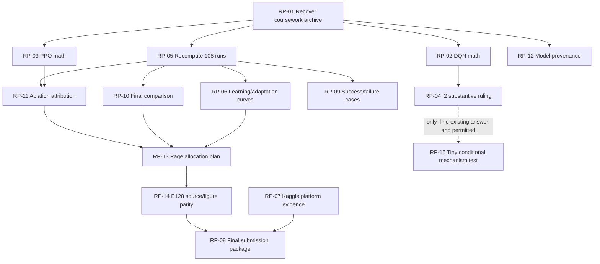

# ARC-AGI-3 — DEPENDENCY-AWARE REPAIR PLAN

**Plan date:** 2026-10-27 SAST; lecturer deadline **23:59 SAST today**. **Inputs:** 5-page `RL_Assignment(1).pdf`; E128 current 8-main-page research report; judicial [assessment](JUDICIAL_ASSESSMENT_20261027.md); [requirement matrix](REQUIREMENT_TO_EVIDENCE_MATRIX.md); [evidence ledger](EVIDENCE_LEDGER.md); [repair register](REPAIR_REGISTER.md); `Stralb/arc-agi-3-rl-research` main source baseline `49b966d06afe8ee2a51da100801bf7d5ae63eebf` and `archive/full-research-2026-10-27`.

**Planning only — no paper, code, raw experiments or user-owned cluster assets modified.** All proposed outputs are conditional on source availability and should be written to the dedicated audit branch or a private non-destructive local workspace. **Effort:** Low/Medium/High relative, not a promise of completion time. **Risk:** risk of scientific/implementation error if executed, not a claim of defect. No task is graded independently; marks categories overlap, so do not add them.

## Target and stop rules

1. Maximise *validated existing evidence* first; do not start a new large DQN/PPO training campaign.
2. Treat coursework `4 games × 3 policy seeds 301–303 × 256 calls`, older `e078_course_recovery` `vc33 × 160 calls × seeds28901–28903`, separate Phase3N cross-game notebook `48 trials / seeds11,17,23`, and N-series/E126 `25 exposed families / 200-per-level` as **different protocols**. None may substitute for the original 72-run study.
3. Never convert a time-to-first-native-reward cumulative distribution into an evaluated learning curve without showing an actual change in learned-policy effectiveness. Pure loss/Brier calibration is not equivalent to native task progress.
4. Avoid reruns/new native actions unless they answer one necessary unresolved claim that existing logs cannot answer and there is time. No high-risk retraining by default.
5. Preserve original sources, reports, checkpoints, results, hashes, Kaggle receipts and permissions; read-only inspection first. Reproduce with original config, verify before deciding edits. Deadline-related external actions require actual platform records.

## Immediate evidence inventory discoveries

- Archive `experiments/INDEX.md` lists N-series and E126, **not** the 72-run DQN/PPO coursework source; the published GitHub subset is known incomplete.
- Historical `home_directories_depth3.txt` in the user's files records `/home-mscluster/astrauss/e078_course_recovery/` and old run folders, but **different seeds and budget**; it is only a locator. Separate `Cross_Game_Native_DQN_PPO_Research.ipynb` documents a Phase3N 48-run transfer study, also not direct evidence for E128 Table1.
- Main `results/e126_per_game.csv` has 1125 rows, `first_win_step`: 38/75 baseline vs 42/75 trained-hybrid game-seed episodes have at least one recorded win; supports *attainment-vs-budget*, not neural training learning curve. Original 75×2 games use distinct arms with differing action totals.
- Archive `data/outputs/experiments/N117_effect_prior/candidate_action_audit.csv` has 2707 action rows with pre/post-frame hashes, pixels, native reward, terminal status; `prequential_native_actions.csv` has 5965 prediction-label records. Archive `data/outputs/experiments/N117/action_audit_baseline_local.csv` is **0 bytes** and must not be cited as existing row-level audit.
- Archive N118/N119 per-family and N120 comparison files have failure/terminal/silent action information; N117 13-game controls and 45×25 E124–E126 arm results are recoverable from published CSV. These are *supplemental* to coursework, never a replacement.
- Main `scripts/generate_plots.py` plots N-series public outcomes, not proven E128 figure source; no exact matching E128 LaTeX source identified in inspected repository.

## Execution queue

| TASK_ID | Priority | Exact action | Prerequisites | Output | Status |
|---|---|---|---|---|---|
| **RP-01** | P0 | Recover and freeze exact six-arm coursework provenance | None | audit/coursework_provenance_manifest.csv plus source-path map and availability verdict (metadata only | BLOCKED ON ORIGINAL COURSEWORK ARCHIVE; inspectable prior folder leads located |
| **RP-02** | P0 | Audit genuine Double DQN learning and legal-action representation | RP-01 | audit/dqn_implementation_audit.md and unit-test evidence with PASS/FAIL/NOT_TESTED per invariant. | BLOCKED ON ORIGINAL DQN SOURCE |
| **RP-03** | P0 | Audit PPO actor–critic, GAE and masked click probabilities | RP-01 | audit/ppo_probability_and_update_audit.md plus reproducible tests/observed logs, distinguishing actual vs mock | BLOCKED ON ORIGINAL PPO SOURCE |
| **RP-04** | P0 | Adjudicate DQN-I2 substantive intervention, without hand-waving | RP-01, RP-02 | audit/dqn_i2_substance_ruling.md and action-difference table | BLOCKED ON ORIGINAL I1/I2 CODE |
| **RP-05** | P0 | Independently reaggregate all coursework runs, first rewards and resource costs | RP-01; RP-02/03 for interpreting update fields | audit/coursework_episodes_recomputed.csv | BLOCKED ON ORIGINAL 108 RUN RECORDS |
| **RP-06** | P0 | Determine whether valid learning/adaptation curves are reconstructable | RP-01, RP-05 (if run telemetry needed) | audit/curve_feasibility.md plus reproducible dataset/plot if scientifically valid | READY for feasibility screening; underlying course telemetry recovery BLOCKED |
| **RP-07** | P0 | Authenticate official Kaggle entry and class nomination | None (can run concurrently) | audit/kaggle_submission_provenance.md and receipt/hash references | BLOCKED ON AUTHENTICATED KAGGLE/CLASS RECORD |
| **RP-08** | P0 | Complete team contributions and external submission audit | RP-07 for Kaggle; RP-14 for final source parity | audit/submission_release_manifest.md and completed checklist with verifiable references (no fake receipts). | PARTLY READY; BLOCKED ON ACTUAL MEMBER ROLES AND PLATFORM RECEIPTS |
| **RP-09** | P1 | Recover underused success and failure trajectory evidence | RP-05 for coursework; archive E126/N-series portions READY | audit/failure_success_evidence_index.csv and figure/story candidates with direct record references. | READY for N-series; course arm examples BLOCKED |
| **RP-10** | P1 | Strengthen the final DQN/PPO comparison without new training | RP-05 | audit/coursework_matched_comparison.csv plus one compact legible candidate figure/table and concise limitation | BLOCKED ON COURSE EPISODE DATA; paper-only layout sketch possible |
| **RP-11** | P1 | Map genuine ablations to exactly the mechanisms they test | RP-05 for PPO raw; current E126/N117 sub-study READY | audit/ablation_attribution_matrix.md with PROVED/REPORT_ONLY/UNIDENTIFIED labels per effect. | PARTLY READY; PPO source verification BLOCKED |
| **RP-12** | P1 | Account for external pretrained model and rights separately | RP-01 for DQN model; E126 files READY | audit/pretraining_resource_and_rights.md, two distinct model provenance entries. | PARTLY READY; DQN encoder/permission BLOCKED |
| **RP-13** | P2 | Plan lean E126 narrative and reallocate main-page evidence | RP-06, RP-10, RP-11 | audit/e128_page_allocation_plan.md with exact section/figure movements, not rewritten paper. | READY for outline; final layout BLOCKED ON RECOVERED COURSE EVIDENCE |
| **RP-14** | P2 | Restore exact E128 LaTeX/figures and final reproducibility parity | RP-13 for final layout; can begin source discovery concurrently | audit/report_build_manifest.md and reproducible working-copy LaTeX/figures if permitted, original untouched. | BLOCKED ON EXACT E128 TEX SOURCE; preliminary PDF checks READY |
| **RP-15** | P3 | Conditional tiny mechanism test only if necessary and feasible | RP-01, RP-02, RP-04, RP-05; optional only if essential | audit/conditional_i2_control_protocol.md and bounded test records only if explicitly triggered by preceding au | DEFERRED / NOT AUTHORISED BY DEFAULT |

## Task dossiers: exact source, marks, required evidence, effort, risk and verification

### RP-01 — Recover and freeze exact six-arm coursework provenance (P0)

- **Deficiency corrected:** Judicial CP-01/06: original DQN/PPO source, per-arm configs and raw runs not independently linked to E128.
- **Rubric marks affected:** Baselines 20; iterative 25; rigour 25; report 10.
- **Existing evidence:** E128 §3–4/Table1 describes 4 families × 3 policy seeds 301–303 × six arms at 256 calls; historical home_directories_depth3.txt shows /home-mscluster/astrauss/e078_course_recovery but its vc33/160-action seed28901–28903 runs are NOT the 72-run E128 panel. The GitHub archive experiments/INDEX.md lacks this panel.
- **Required source files:** Owner-held original coursework archives and cluster runs; /home-mscluster/astrauss/e078_course_recovery (historical lead only); any E128-associated frozen source/log manifest; manuscript Table1; archive/experiments/INDEX.md. Also inspect the original archive before treating any `E127_FULL_RUNNABLE_NATIVE_PROJECT_20261021.zip` as related: a separate E128 temporal-state study references that name.
- **New evidence required:** Exact six arm source files, SHA256, seed config, environment version, checkpoint provenance, training/evaluation mode and per-episode record references for all 72 main and 36 controls.
- **Exact action:** Read-only locate candidate files first; compare actual games/seeds/action ceilings and source hashes; reject wrong E078/Phase3N experiment variants; store an immutable manifest of what is truly matched; never modify originals.
- **Expected output:** audit/coursework_provenance_manifest.csv plus source-path map and availability verdict (metadata only; store sensitive original assets privately).
- **Implementation effort:** Medium–High
- **Risk of introducing errors:** Low to originals if read-only; high risk of mixing unrelated studies if protocol matching skipped.
- **Expected scientific benefit:** Opens the highest-mark evidence recovery and prevents scientific misattribution.
- **Acceptance criteria:** Six unique arm IDs; 4×3 cells per arm; all 36 controls identified; every result mapped to a source/config/seed and SDK version, or explicitly MISSING.
- **Verification test:** Manifest uniqueness and SHA checks; per-arm row count 12; compare config (games ar25/g50t/s5i5/vc33, native seed47, policy seeds301–303, cap256). Independently review unmatched records.
- **Dependencies:** None
- **Status:** BLOCKED ON ORIGINAL COURSEWORK ARCHIVE; inspectable prior folder leads located

### RP-02 — Audit genuine Double DQN learning and legal-action representation (P0)

- **Deficiency corrected:** Claimed trained DQN-V0/I1/I2 may differ from textbook target and neural parameter-update behavior.
- **Rubric marks affected:** Problem 10; baselines 20; improvements 25.
- **Existing evidence:** E128 §3 reports Double DQN, target network, Huber/dueling candidate scoring and counters (360/361 updates); N093 empirical Bellman source must not be treated as the coursework DQN.
- **Required source files:** RP-01 identified DQN-V0/I1/I2 exact implementation, original optimizer logs and checkpoint snapshots; E128 Eq(1) and Table1.
- **New evidence required:** State/history encoder shape, legal-action and 64×64 click mapping, replay sampling, Double DQN next-action/target evaluation, terminal vs truncation masks, target-sync policy, parameter-delta evidence.
- **Exact action:** Read source at action selection, replay, bootstrap and optimizer calls; construct pure isolated invariant tests using archived transitions/checkpoints without new SDK action costs.
- **Expected output:** audit/dqn_implementation_audit.md and unit-test evidence with PASS/FAIL/NOT_TESTED per invariant.
- **Implementation effort:** Medium
- **Risk of introducing errors:** Low for read-only unit checks; medium if missing framework versions distort tests.
- **Expected scientific benefit:** Establishes two/three DQN stages as actual learned policies, not claimed update counters.
- **Acceptance criteria:** Source shows genuine nonzero gradients/parameter changes in active learner, proper target detach, legal next-action mask, correct terminal behavior; any fault documented with minimal patch proposal, not silent modification.
- **Verification test:** Freeze before/after tensors, target calculation on synthetic legal-action/done cases, action-index roundtrip, seeded replay metadata.
- **Dependencies:** RP-01
- **Status:** BLOCKED ON ORIGINAL DQN SOURCE

### RP-03 — Audit PPO actor–critic, GAE and masked click probabilities (P0)

- **Deficiency corrected:** PPO-I2's logged old/current masked click probabilities and terminal bootstraps are unverified.
- **Rubric marks affected:** Problem 10; baselines 20; improvements 25; rigour 25.
- **Existing evidence:** E128 Eq(2) and §3.2 describe factorised actor–critic, conditional click mask at 65% modal colour and intrinsic reward for I1, but source is not in inspected public repo.
- **Required source files:** RP-01 PPO-V0/I1/I2 scripts, rollout buffers, saved masks/action indexes/log-probs, optimizer and old-policy checkpoints; original mask-only/no-updates scripts.
- **New evidence required:** Proof that rollout mask is stored/reconstructed identically for old/new policies; joint logπ(type)+logπ(x,y|type), entropy, clipped ratio, GAE terminal/truncation, native vs shaped reward accounting, gradient steps.
- **Exact action:** Evaluate collected old logπ vs recomputed pre-update logπ, check legal-action mask/action support, finite importance ratios and GAE on simple terminal sequences, inspect actual gradient parameter deltas.
- **Expected output:** audit/ppo_probability_and_update_audit.md plus reproducible tests/observed logs, distinguishing actual vs mocked checks.
- **Implementation effort:** Medium–High
- **Risk of introducing errors:** Medium; using different torch version or misreading coordinate conditioning could lead to false bugs.
- **Expected scientific benefit:** Eliminates or confirms the largest latent PPO implementation-correctness risk.
- **Acceptance criteria:** Exact stored/recomputed old log-prob agreement within documented numerical tolerance; legal support never assigned impossible action, proper terminal GAE, nonzero updates and native reward untouched by novelty bonus.
- **Verification test:** Explicit deterministic toy examples and archived-rollout invariants with source SHA and tool versions.
- **Dependencies:** RP-01
- **Status:** BLOCKED ON ORIGINAL PPO SOURCE

### RP-04 — Adjudicate DQN-I2 substantive intervention, without hand-waving (P0)

- **Deficiency corrected:** Lecturer forbids mere hyperparameter tweaks; E128 describes reward-stall floor epsilon>=0.75 after 96 actions.
- **Rubric marks affected:** Iterative 25 (major eligibility risk); rigour 25.
- **Existing evidence:** E128 §3.2 and Table1 report I1 and I2 tied on two vc33 wins and I2 stall branch active 1769/3072 times; neither observation establishes a new mechanism. Archived e078 contains differently configured old I2 runs only.
- **Required source files:** RP-01 true DQN-I1 and I2 source/config/action logs, stall counter events, RNG states, earlier alternative DQN intervention source if actually matched.
- **New evidence required:** Exact branch predicate and state, update/reset logic, differences in legal type/click selection, paired I1/I2 actions, rewards and any epsilon-only comparator already conducted.
- **Exact action:** Code-diff I1→I2; identify whether change is solely a conditional scalar epsilon schedule; reconstruct trigger series and per-run counter/action rates; write bounded classification: SUBSTANTIVE / BORDERLINE / TUNING / UNVERIFIED.
- **Expected output:** audit/dqn_i2_substance_ruling.md and action-difference table; if merely tuning, a truthful deficiency flag and evidence-backed alternative from original archive if one exists.
- **Implementation effort:** Medium
- **Risk of introducing errors:** Low if not modifying source; high if retroactively rebranding tuning as scientific novelty.
- **Expected scientific benefit:** Directly addresses lecturer's substantive-improvement rule, potentially protecting a large share of iterative marks.
- **Acceptance criteria:** Classification backed by actual code, counter traces and comparator; no claim of learning gain from activation count alone. If only tuning, do not call fully compliant and do not invent replacement.
- **Verification test:** Same-source hash and per-run action/effect trace comparisons; inspect any pre-existing matched ablation; original 96/0.75 control reproduced from program.
- **Dependencies:** RP-01, RP-02
- **Status:** BLOCKED ON ORIGINAL I1/I2 CODE

### RP-05 — Independently reaggregate all coursework runs, first rewards and resource costs (P0)

- **Deficiency corrected:** 108 original run outcomes, timing, update and censoring records cannot yet be checked from public repo.
- **Rubric marks affected:** Baselines 20; improvements 25; rigour 25; report 10.
- **Existing evidence:** E128 Table1/Fig2 has 72 six-stage +12 random +24 PPO controls; DQN-I1 361 vs simple 360 update schedule requires explanation; N093/E126 tables are different protocols.
- **Required source files:** RP-01 core/control logs and SDK scorer/version, training and evaluation timestamps, archived summary scripts (if present), E128 Table1/Fig2.
- **New evidence required:** One row per run: arm, game, policy seed, native seed, budget, actions charged, L1/L2/L3 events, SDK score, first_reward_step, GAME_OVER/truncation, updates and timing; hardware/software metadata.
- **Exact action:** Produce read-only parser over original logs, independently recompute all Table1 totals/means and exact success/failure cells, compare training reward separately, and resolve 361 update discrepancy only from code.
- **Expected output:** audit/coursework_episodes_recomputed.csv; audit/coursework_table_reconciliation.md; explicit source-to-cell checksums.
- **Implementation effort:** Medium
- **Risk of introducing errors:** Medium due to heterogeneous log schema, GAME_OVER vs cap and incomparable train/inference time.
- **Expected scientific benefit:** Replaces self-reported headline counts with independently checked coursework evidence and strengthens comparison immediately.
- **Acceptance criteria:** 72 unique core cells (6×4×3), 12 random, 24 control, no duplicate IDs, all original outcomes/steps agreed or flagged; score native unmodified; source linkage for every row.
- **Verification test:** Automated raw-to-summary aggregate equality, manual spot checks of win/failure raw traces and all non-matches explicitly listed.
- **Dependencies:** RP-01; RP-02/03 for interpreting update fields
- **Status:** BLOCKED ON ORIGINAL 108 RUN RECORDS

### RP-06 — Determine whether valid learning/adaptation curves are reconstructable (P0)

- **Deficiency corrected:** Judicially sustained lecturer §5 gap; Figure2 event times are not a learning curve.
- **Rubric marks affected:** Rigour 25; report 10.
- **Existing evidence:** E128 Figure2 has cumulative within-run first-reward event timings; main results/e126_per_game.csv includes first_win_step for 38/75 N117 and 42/75 E126 episodes; archived N117 effect-prior prequential traces track model_train_n; these measure outcomes/effect prediction, not necessarily better DQN/PPO performance.
- **Required source files:** RP-01 original DQN/PPO rollout/optimizer/checkpoint evaluations, per-step native outcomes and scores; main/results/e126_per_game.csv; archive/data/outputs/experiments/N117_effect_prior/prequential_native_actions.csv; E128 Figure2.
- **New evidence required:** If available, budget-indexed repeated policy performance evaluations or valid online adaptation metric tied to actual policy changes, before/after update and outcome, with 3 seeds and clear denominators; identify which records are only loss or event timestamps.
- **Exact action:** Audit timestamps and independent outcome metrics first. Build curve only if measurements genuinely quantify change with training/adaptation; do NOT relabel first-win CDF or pure TD loss as learning curve. Use E126 budgeted attainment only as clearly separate descriptive progress figure.
- **Expected output:** audit/curve_feasibility.md plus reproducible dataset/plot if scientifically valid; otherwise explicit MISSING decision and original Figure2 retained with honest label.
- **Implementation effort:** Medium if logged; High only if original data incomplete (do not initiate large retraining by default).
- **Risk of introducing errors:** High risk of misleading interpretation; low if strict qualification gate enforced.
- **Expected scientific benefit:** Directly closes confirmed mandatory rubric gap when valid primary metrics exist.
- **Acceptance criteria:** Each plotted point has source actions/checkpoint/metric and seed denominator, outcome not merely training loss; improvement/adaptation claim limited to measured scope; original run records unchanged.
- **Verification test:** Data lineage and monotonic interaction-budget checks, direct plot regeneration, sample audit, verify no unseen-game/generalization inference.
- **Dependencies:** RP-01, RP-05 (if run telemetry needed)
- **Status:** READY for feasibility screening; underlying course telemetry recovery BLOCKED

### RP-07 — Authenticate official Kaggle entry and class nomination (P0)

- **Deficiency corrected:** E128 says E126 57690887 scored 0.33; repo manifest says candidate not submitted at earlier snapshot; class leaderboard is separately worth 10.
- **Rubric marks affected:** Leaderboard 10; report 10; mandatory submission eligibility.
- **Existing evidence:** main/release/manifest.json gives agent SHA84f27a25...7005178c, notebook SHA6bbbbc5c..., status false; scripts/verify_e126_release.py checks offline parity only. E128 p7 reports later ID/score.
- **Required source files:** Authentic Kaggle submission details and notebook version for ID57690887; manifest, E126_Kaggle_Candidate.ipynb, release/build_candidate.py, nominated class registration; official class assessment record if available.
- **New evidence required:** Server-scored status, score, SAST timestamp, team identity, exact submitted notebook/artifact hash and nominated eligible class-team rank/entry.
- **Exact action:** Compare original platform record chronologically to earlier repo snapshot; record official vs local metrics in distinct columns; never overwrite historical manifest solely to force consistency.
- **Expected output:** audit/kaggle_submission_provenance.md and receipt/hash references; leaderboard assessment explicitly UNKNOWN until class rank verified.
- **Implementation effort:** Low–Medium if account records available
- **Risk of introducing errors:** Low if historical status retained; high if local scores presented as official.
- **Expected scientific benefit:** Resolves major compliance risk independently of model scientific sophistication.
- **Acceptance criteria:** One unambiguous official successful submission with source and timestamp before lecturer deadline; nominated class entry and actual class rank if known; if not, explicit unavailable.
- **Verification test:** Screenshot/API official receipt and SHA match to preserved notebook; SAST conversion; independent check of entry/team eligibility.
- **Dependencies:** None (can run concurrently)
- **Status:** BLOCKED ON AUTHENTICATED KAGGLE/CLASS RECORD

### RP-08 — Complete team contributions and external submission audit (P0)

- **Deficiency corrected:** E128 p8 leaves contributions incomplete; Moodle ZIP and Paper Track evidence not verified.
- **Rubric marks affected:** Report 10 and eligibility (not a substitute for leaderboard rank).
- **Existing evidence:** E128 eight main pages/two reference pages, three author IDs; main E126 notebook and builder available; existing audit/SUBMISSION_CHECKLIST.md.
- **Required source files:** Assignment PDF §6; E128 manuscript and exact .tex; final notebook, actual author roles, Paper Track record/link/saved text and Moodle submission receipt/zip.
- **New evidence required:** Truthful author-by-author work summary, final named ZIP manifest, official Paper Track and Moodle timestamps, no secret leakage.
- **Exact action:** Audit existing evidence and package structure; add factual contribution statement; verify actual external upload from receipts, or mark pending; preserve credentials and rights.
- **Expected output:** audit/submission_release_manifest.md and completed checklist with verifiable references (no fake receipts).
- **Implementation effort:** Low–Medium
- **Risk of introducing errors:** Low for bookkeeping; severe risk if fabricated roles/status or unintended checkpoint redistribution.
- **Expected scientific benefit:** Directly meets mandatory report/submission requirements without new RL work.
- **Acceptance criteria:** Every author listed with real role; ZIP includes matching PDF/notebook/code and receipts as prescribed; Paper Track link/text present; credentials scan clean; external confirmation true or pending stated.
- **Verification test:** Unpack/archive listing, SHA manifest, URL/receipt checks, credential scan and deadline check.
- **Dependencies:** RP-07 for Kaggle; RP-14 for final source parity
- **Status:** PARTLY READY; BLOCKED ON ACTUAL MEMBER ROLES AND PLATFORM RECEIPTS

### RP-09 — Recover underused success and failure trajectory evidence (P1)

- **Deficiency corrected:** Failures, silent actions, termination/censoring and representative action changes are underexplained; results are sparse.
- **Rubric marks affected:** Rigour 25; improvements 25; report 10.
- **Existing evidence:** Archive N117_effect_prior/candidate_action_audit.csv has ~2707 action rows with native_reward, terminal, delta_pixels and SHA; prequential_native_actions.csv has ~5965 labelled records; N118/N119 per_family and N120 comparison tables capture silent actions, GAME_OVER, Level3 counts; public N117/action_audit_baseline_local.csv is currently 0 bytes.
- **Required source files:** Archive data/outputs/experiments/N117_effect_prior/{candidate_action_audit.csv,prequential_native_actions.csv}, N118/per_family.csv, N119/per_family.csv, N120/comparison_25.csv; main/results/e126_per_game.csv; RP-05 coursework logs if recovered.
- **New evidence required:** Evidence-indexed representative genuine successes/failures with family, arm, seed, charged-action timestamp, reason/terminal status, label of data lineage; identify if any original coursework failure trace exists.
- **Exact action:** Read-only classify native wins, no reward under cap, terminal earlier, visually silent, changed-pixels-no-native reward; select 1–2 real examples per relevant coursework arm if raw logs exist; else use N-series only as separate case study.
- **Expected output:** audit/failure_success_evidence_index.csv and figure/story candidates with direct record references.
- **Implementation effort:** Low–Medium
- **Risk of introducing errors:** Medium if failure cause inferred from pixels or N-series rebranded as coursework.
- **Expected scientific benefit:** Stronger scientific explanation and meaningful failure analysis without training.
- **Acceptance criteria:** Every example has raw source/seed/action row, native reward and terminal evidence; no causal explanation from correlations alone; clear coursework vs N-series label.
- **Verification test:** Spot-check all selected examples and recompute denominators; no missing terminal/censor fields silently assumed.
- **Dependencies:** RP-05 for coursework; archive E126/N-series portions READY
- **Status:** READY for N-series; course arm examples BLOCKED

### RP-10 — Strengthen the final DQN/PPO comparison without new training (P1)

- **Deficiency corrected:** E128 mainly aggregates rare wins; decision metrics, failure cases, censor and resources can add analytical power.
- **Rubric marks affected:** Rigour 25; baselines 20; improvements 25.
- **Existing evidence:** E128 Table1/Fig2 reports DQN 0/2/2, PPO 0/0/1, fixed 256 calls and game-seed success details; reported first reward at vc33 114/21 and s5i5 one case; full 108 run records still missing.
- **Required source files:** RP-05 recomputed course episodes, raw action logs if available; E128 Table1; original resource and update records.
- **New evidence required:** Per-game per-seed matched six-arm outcome matrix, native first-reward survival/censor, levels, actions, update counts, in-run walltime and separate trained prior; descriptive variance only.
- **Exact action:** Calculate arm×game×seed table, pairwise V0→I1→I2 and DQN-I2 vs PPO-I2 matched differences; report gains/losses/no changes; distinguish failure at cap vs GAME_OVER; avoid significance on three positives.
- **Expected output:** audit/coursework_matched_comparison.csv plus one compact legible candidate figure/table and concise limitations.
- **Implementation effort:** Low–Medium once RP-05 complete
- **Risk of introducing errors:** Low if no unsupported p-values/generalization; medium if per-step records missing and paper-only counts are falsely 'verified'.
- **Expected scientific benefit:** Directly improves required final-algorithm comparison and rigour from existing work.
- **Acceptance criteria:** All 12 game×seed cells represented for each arm; paired differences and failures explicit, no double counting; report distinguishes reported-vs-recomputed data.
- **Verification test:** Cross-check table against source episode rows and Table1, manual inspect each nonzero pair.
- **Dependencies:** RP-05
- **Status:** BLOCKED ON COURSE EPISODE DATA; paper-only layout sketch possible

### RP-11 — Map genuine ablations to exactly the mechanisms they test (P1)

- **Deficiency corrected:** DQN-I1 bundle, PPO novelty/mask and E126 historical controls must not be merged into false causal claims.
- **Rubric marks affected:** Improvements 25; rigour 25.
- **Existing evidence:** E128 reports PPO mask-only/no-updates 12 each; main/results/n117_ablations.csv and e126_all_arms.csv cover N117/E124/E125/E126 controls; archive E126 E127_AUDIT.md explains rarity/effect-only and random/salience controls.
- **Required source files:** RP-01 original PPO control scripts/trajectories; main/results/n117_ablations.csv, e126_all_arms.csv, e126_per_game.csv; archive/experiments/E126/results/E127_AUDIT.md.
- **New evidence required:** Mechanism-to-control mapping: what is held fixed, what changes, within which protocol, observed native outcome and inference bound. DQN-I1 component ablations only if genuinely present.
- **Exact action:** Make separate matrices for coursework PPO/DQN and separate N117/E126 family; quantify existing controls; check mask-only and no-update actual reward with original sources; do not claim control proves learning if no updates.
- **Expected output:** audit/ablation_attribution_matrix.md with PROVED/REPORT_ONLY/UNIDENTIFIED labels per effect.
- **Implementation effort:** Low–Medium
- **Risk of introducing errors:** Medium when cross-lineage controls are incorrectly interpreted as course ablations.
- **Expected scientific benefit:** Improves attribution and sharpens null-result interpretations without new runs.
- **Acceptance criteria:** Every causal claim identifies matching contrast and source, and DQN-I1 unique component attribution remains unavailable unless original ablations verify it.
- **Verification test:** Recompute recorded controls from CSVs; compare protocol columns and source SHA; record discrepancies.
- **Dependencies:** RP-05 for PPO raw; current E126/N117 sub-study READY
- **Status:** PARTLY READY; PPO source verification BLOCKED

### RP-12 — Account for external pretrained model and rights separately (P1)

- **Deficiency corrected:** DQN-I1/I2 pretraining not included in reported runtime, and E126 teammate checkpoint rights unresolved.
- **Rubric marks affected:** Rigour 25; report 10; research integrity.
- **Existing evidence:** E128 §4 states unequal prior compute, archived docs/DATA_AND_LICENSES.md warns peer model distribution; main/release/manifest.json has E126 checkpoint hash c5882f...b9, frozen source hashes.
- **Required source files:** Original coursework DQN-I1 pretrained encoder training manifests, data/split and hardware records; E125 checkpoint provenance and actual teammate permission; archived docs/DATA_AND_LICENSES.md; release/manifest.json.
- **New evidence required:** Separate provenance and expense rows for DQN coursework encoder vs E125 peer CNN, full training dataset exposure, licence/permission, frozen/evaluation modes and inference costs.
- **Exact action:** Audit exact model identities/checksums and source owners, attribute correctly, quantify archived compute only when logged, treat unavailable as unknown, do not infer costs from checkpoint size.
- **Expected output:** audit/pretraining_resource_and_rights.md, two distinct model provenance entries.
- **Implementation effort:** Low–Medium
- **Risk of introducing errors:** Medium for mistaken identity/licensing or invented cost.
- **Expected scientific benefit:** Closes important fairness and attribution concerns while preserving honest limits.
- **Acceptance criteria:** Source-owner and checkpoint hashes distinct, evidence-supported resource table, permission status explicit; no rights assertion without proof.
- **Verification test:** Hash models, compare source import paths and load mode, inspect training metadata and permission records.
- **Dependencies:** RP-01 for DQN model; E126 files READY
- **Status:** PARTLY READY; DQN encoder/permission BLOCKED

### RP-13 — Plan lean E126 narrative and reallocate main-page evidence (P2)

- **Deficiency corrected:** Separate N118–E126 story may obscure rubric-critical six-arm DQN/PPO analysis within the eight-page cap.
- **Rubric marks affected:** Report 10; improvements 25; rigour 25.
- **Existing evidence:** E128 main body 8 pages; already separates Figure1 lineage; N118 shows calibration improved without native extra levels; E126 28/75 action divergences, six local score improvements, four extra levels concentrated in two families; N119/N120 negative details in archive.
- **Required source files:** Original E128 .tex and figures (not yet identified in GitHub), E128 PDF §3–6, RP-06 curves, RP-10 matched table, archive reports/N118_FINDINGS.md and E126 results.
- **New evidence required:** Page/word/figure budget and precise table/figure replacement map; verify which critical course evidence is recovered before proposing text changes.
- **Exact action:** Draft *outline only*: coursework methods/results/curve/controls prominent; E126 concise mechanistic extension with 3-tier metrics and explicit post hoc exposure; move N119/N120 detail into appendix/link if permitted without hiding necessary evidence.
- **Expected output:** audit/e128_page_allocation_plan.md with exact section/figure movements, not rewritten paper.
- **Implementation effort:** Low
- **Risk of introducing errors:** Medium if trimming discards essential negative evidence or exceeds 8 main pages.
- **Expected scientific benefit:** Aligns report emphasis with actual lecturer criteria and scientific thesis.
- **Acceptance criteria:** No required rubric item loses main-text coverage; E126 lineage, two-family concentration, no unseen transfer and N118 negative claim retained; main count ≤8.
- **Verification test:** Rubric matrix line-by-line against outline; rendered existing PDF page map, no edits.
- **Dependencies:** RP-06, RP-10, RP-11
- **Status:** READY for outline; final layout BLOCKED ON RECOVERED COURSE EVIDENCE

### RP-14 — Restore exact E128 LaTeX/figures and final reproducibility parity (P2)

- **Deficiency corrected:** Main repository plotting scripts reproduce N-series SVGs, not necessarily E128 manuscript figures; RLC template source parity unverified.
- **Rubric marks affected:** Report quality/reproducibility 10.
- **Existing evidence:** main/scripts/generate_plots.py and summarize_results.py use N-series public CSV; E128 PDF eight main + two references; no exact matching LaTeX project located in inspected GitHub indexes.
- **Required source files:** Original E128 source .tex, bibliography, figure-generation scripts/assets, RLC 2026 template; actual E128 PDF; main scripts/generate_plots.py only as limited reference.
- **New evidence required:** Exact source files and immutable hashes, compilation toolchain/settings, figure-to-data lineage, citation checks, final rendered PDF byte/layout correspondence.
- **Exact action:** Locate source before edits; compile copy in separate build directory; verify RLC cover disabled and untouched margins/fonts, 8 main pages and fig axes/denominators; no conversion to unrelated template.
- **Expected output:** audit/report_build_manifest.md and reproducible working-copy LaTeX/figures if permitted, original untouched.
- **Implementation effort:** Medium
- **Risk of introducing errors:** Medium due to silent LaTeX layout changes or unsupported figure regeneration.
- **Expected scientific benefit:** Secures formatting and source reproducibility marks and makes later surgical corrections safe.
- **Acceptance criteria:** Exact source rebuild matches content, main ≤8 pages, all figure numerics provenance-backed, no accidental missing references or altered experiment values.
- **Verification test:** Render-and-compare page PNGs, inspect all captions and page boundaries, compile logs/standard template diff.
- **Dependencies:** RP-13 for final layout; can begin source discovery concurrently
- **Status:** BLOCKED ON EXACT E128 TEX SOURCE; preliminary PDF checks READY

### RP-15 — Conditional tiny mechanism test only if necessary and feasible (P3)

- **Deficiency corrected:** DQN-I2 could remain borderline tuning after code review, with no existing substantive alternative in original records.
- **Rubric marks affected:** Potential iterative 25, but no guaranteed return; optional conditional experiment.
- **Existing evidence:** E128 stall-epsilon rule as reported; no proven new mechanism, and no full alternate DQN ablation identified.
- **Required source files:** RP-04 source-mechanism verdict, RP-01 exact DQN code and same 4×3/256 evaluation harness, available legal native SDK; no exploration outside course restrictions.
- **New evidence required:** Only if absolutely needed, a preregistered minimal contrast isolating I2 conditional switching from a fixed-epsilon schedule (or a genuinely different already-implemented mechanism).
- **Exact action:** Do not start by default. If existing logs cannot answer and adequate time/permissions remain, freeze both policies, one controlled hypothesis and one bounded legal SDK evaluation; report honest null result, no re-tuning based on observed game outcomes.
- **Expected output:** audit/conditional_i2_control_protocol.md and bounded test records only if explicitly triggered by preceding audit.
- **Implementation effort:** High relative to remaining deadline and uncertain benefit
- **Risk of introducing errors:** High (new results could invalidate paper timing/budgets or create post-selection bias).
- **Expected scientific benefit:** Could clarify substantive exploration mechanism, but must not displace mandatory evidence recovery.
- **Acceptance criteria:** Decision gate documented; predeclared contrast, identical budgets/seed/software, original untouched; change demonstrates mechanism not merely a revised tuned threshold, or labelled negative.
- **Verification test:** Frozen-code SHA/config, per-run logs, no hidden data, match protocol and interpret only observed comparisons.
- **Dependencies:** RP-01, RP-02, RP-04, RP-05; optional only if essential
- **Status:** DEFERRED / NOT AUTHORISED BY DEFAULT

## Dependency DAG and recommended order

**Parallel ready work:** RP-07 external receipt verification, RP-08 true role/receipt collection, RP-06 feasibility screening, RP-09 N-series failure extraction, RP-11 E124–E126 ablation mapping, RP-12 E126 peer checkpoint provenance, RP-13 page outline, RP-14 manuscript source discovery. None closes original DQN/PPO source verification until RP-01 succeeds.

**Stop before doing:** a new generic PPO/DQN retraining campaign; relabelling E126 as coursework algorithm; substituting Phase3N/old e078 results into E128; calling first reward timing learning; claiming official Kaggle score from SDK CSV; adding unsupported team roles/credits/rights; silently changing an already submitted report or submission receipts.

## Definition of completion

- Every rubric-critical claim has a primary source hash and a VERIFIED / SUPPORTED BUT LIMITED / UNVERIFIED / CONTRADICTED / MISSING status.
- All 108 core/control episode rows either reconcile from original logs or remain explicitly unverified; no synthetic rows.
- DQN-I2 and PPO-I2 correctness classified by original source; no speculative acquittal or failure verdict.
- Curves genuinely reflect learning/adaptation against budget or missing requirement transparently admitted.
- Official Kaggle class nomination and submission proof stored separately from local SDK; exact notebook/code SHA accounted for.
- Final LaTeX and PDF comply with eight-main-page RLC template; actual author roles, required Paper Track and Moodle records confirmed if they exist.
- Three persistent registers (`EVIDENCE_LEDGER.md`, `REPAIR_REGISTER.md`, `SUBMISSION_CHECKLIST.md`) updated when tasks close; no destruction of original research evidence.
